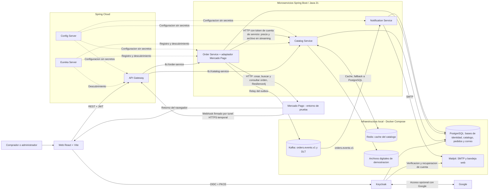
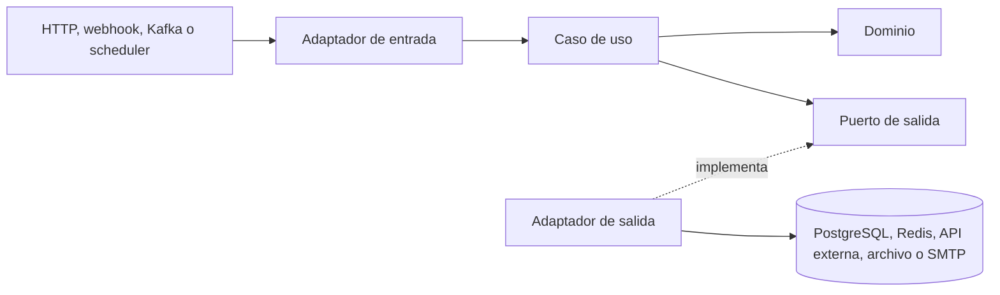

# Arquitectura de alto nivel

El proyecto previsto es una tienda local de productos digitales de demostración. Los pagos usan **Checkout Pro con Orders API** y las credenciales de prueba de una aplicación de Mercado Pago Perú: no se procesará dinero real. Los servicios todavía no están implementados. La estructura prevista del monorepositorio está en [repository-structure.md](repository-structure.md), el trabajo concreto en [user-stories.md](user-stories.md) y las decisiones puntuales en `docs/adr/`.

## Responsabilidades

| Componente                | Propiedad principal                                                                                                                                                                                                    |
| ------------------------- | ---------------------------------------------------------------------------------------------------------------------------------------------------------------------------------------------------------------------- |
| Catalog Service           | Productos, precios en PEN y archivos digitales; Redis solo acelera lecturas públicas.                                                                                                                                  |
| Order Service             | Pedidos, líneas con precio capturado, idempotencia, intentos de pago, reconciliación, webhooks, derechos de descarga y outbox. Es el único servicio que conoce el Access Token de prueba de Mercado Pago. |
| Notification Service      | Inbox de Kafka, reintentos y correos capturados por Mailpit.                                                                                                                                                           |
| Gateway / Eureka / Config | Entrada única y rutas; descubrimiento de instancias; configuración local compartida. Los secretos llegan por variables de entorno.                                                                                     |
| Keycloak                  | Registro, acceso, recuperación de contraseña, verificación de correo y gestión de cuenta; administra sus propias tablas, los roles `CUSTOMER` / `ADMIN` y la cuenta de servicio de Order Service.                      |

## Arquitectura interna: hexagonal + DDD

Catalog, Order y Notification Service usarán **arquitectura hexagonal + DDD pragmático**. DDD define el lenguaje, los límites y las reglas del dominio; puertos y adaptadores separan esas reglas de HTTP, Kafka y persistencia. Cada servicio de negocio posee un contexto delimitado y su base de datos. [DDD Reference de Eric Evans](https://www.domainlanguage.com/ddd/reference/), [puertos y adaptadores](https://alistair.cockburn.us/hexagonal-architecture).

| Contexto                                | Modelo y responsabilidad                                                                                                                                                                                                                           |
| --------------------------------------- | -------------------------------------------------------------------------------------------------------------------------------------------------------------------------------------------------------------------------------------------------- |
| Catálogo (`catalog-service`)            | `Product` es raíz de agregado: precio, publicación y referencia al archivo. Redis solo conserva una copia de lectura.                                                                                                                              |
| Pedidos (`order-service`)               | `Order` es raíz de agregado: líneas con precio capturado, intentos de pago y transiciones de estado. `Entitlement` es un modelo de dominio pequeño, fuente de verdad para autorizar descargas, que se accede mediante `EntitlementRepositoryPort`. |
| Notificaciones (`notification-service`) | `EmailDelivery` es raíz de agregado para deduplicación, estado y reintentos del correo; interpreta el evento de integración, no el agregado `Order`.                                                                                               |
| Identidad (Keycloak)                    | Es un contexto externo. Los servicios guardan el `sub` del usuario, sin copiar credenciales ni tablas de Keycloak.                                                                                                                                 |

En el mapa de contextos, Pedidos consulta Catálogo por HTTP para obtener una **instantánea del producto** (`product_id`, título, precio y moneda), y publica `orders.events.v1` para que Notificaciones reciba `ORDER_PAID`. El adaptador de Mercado Pago traduce los estados del proveedor al lenguaje de Pedidos; ningún modelo externo se incorpora directamente al dominio. Un evento de dominio `OrderPaid` se transforma en el evento de integración versionado que el outbox publica.

Cada servicio de negocio usa `domain/`, `application/` e `infrastructure/`. `domain/model` contiene entidades y objetos de valor Java sin Spring ni JPA; `domain/exceptions` y `domain/events` guardan errores y eventos del negocio. Por ejemplo, `Money` valida moneda e importe y `Order` calcula el total y controla la confirmación del pago. `application/ports/in` expone casos de uso, `application/ports/out` declara dependencias externas y `application/service` los implementa. `infrastructure/adapters/in` recibe HTTP, webhooks, Kafka o tareas programadas; `infrastructure/adapters/out` conecta PostgreSQL, Redis, Mercado Pago, archivos o SMTP. Las reglas se ejecutan en el agregado, no en controladores o entidades JPA. La dependencia del código apunta hacia `application` y `domain`, nunca desde el núcleo hacia infraestructura.

Por pragmatismo, `application` puede usar `@Service` y `@Transactional` de Spring, pero no importa JPA ni clases de `infrastructure`. La regla «un pago confirmado concede acceso a cada producto» vive en el caso de uso, que invoca `Order.markPaid()` y crea los `Entitlement` mediante su puerto. La confirmación del pago se divide en dos componentes: uno **sin transacción** que consulta a Mercado Pago y otro **transaccional** (bean distinto o `TransactionTemplate`) que aplica el resultado; así se evita la auto-invocación de `@Transactional`, que omitiría el proxy. [Transacciones declarativas de Spring](https://docs.spring.io/spring-framework/reference/data-access/transaction/declarative/annotations.html). ArchUnit se configura en HT-01; los tests de dependencia se añaden en HU-03, HU-05 y HU-13, cuando existan clases que verificar.

Order Service consulta el precio de Catalog antes de abrir la transacción que guarda el pedido; también separa las llamadas a Mercado Pago de las transacciones de base de datos. La confirmación del pago actualiza `Order`, concede `Entitlement` y escribe el outbox en una transacción local. Los DTO HTTP, los mensajes Kafka y las entidades JPA quedan en sus adaptadores, sin compartirse como clases Java entre servicios. Gateway, Config Server y Eureka solo necesitan configuración y seguridad Spring, sin un modelo de dominio propio. La distribución concreta de carpetas está en [repository-structure.md](repository-structure.md).

## Cuentas y autenticación

- Habilitar en el realm de Keycloak el registro público, correo único, verificación obligatoria y la opción «Olvidé mi contraseña». Cada cuenta nueva recibe `CUSTOMER`; `ADMIN` se asigna manualmente, nunca desde el registro público. Keycloak envía los enlaces de verificación y recuperación al SMTP de Mailpit. [Guía de administración de Keycloak](https://www.keycloak.org/docs/latest/server_admin/).
- React ofrece enlaces para registrarse, iniciar y cerrar sesión, recuperar el acceso y abrir la consola de cuenta de Keycloak para editar nombre, correo y contraseña. No se implementa un servicio de usuarios ni se almacenan contraseñas en la aplicación.
- La web usa Authorization Code con PKCE mediante `keycloak-js`: conserva los tokens en memoria y los renueva antes de llamar a la API. Gateway y los servicios validan el JWT y aplican roles. Los pedidos guardan `buyer_sub` como identidad estable y `buyer_email` como copia del correo usado al comprar. Order Service rechaza crear pedidos si el token no trae `email_verified=true`. [Adaptador JavaScript de Keycloak](https://www.keycloak.org/securing-apps/javascript-adapter).
- La llamada interna Order → Catalog usa una **cuenta de servicio de Keycloak** (client credentials) con un rol dedicado. Catalog valida ese JWT en `/api/internal/**`; un JWT de comprador no lo autoriza.

## Funciones planificadas para el MVP

| Actor                 | Funciones visibles                                                                                                                                                                                                                                                                            |
| --------------------- | --------------------------------------------------------------------------------------------------------------------------------------------------------------------------------------------------------------------------------------------------------------------------------------------- |
| Visitante             | Explorar productos publicados, buscar por título, ver detalle y preparar un carrito temporal en React. Para pagar debe registrarse o iniciar sesión.                                                                                                                                          |
| Comprador `CUSTOMER`  | Crear un pedido de uno o varios productos digitales, abrir el Checkout Pro de prueba, consultar estado e historial de pedidos y ver su biblioteca de compras. Solo puede descargar productos concedidos tras el webhook de pago aprobado. Ve el estado «pago en revisión» cuando corresponda. |
| Administrador `ADMIN` | Crear y editar productos (los borradores no requieren archivo), cargar el archivo digital, publicar o archivar productos, consultar pedidos y estados de pago y reconciliar intentos en revisión.                                                                                             |
| Sistema               | Procesar webhooks firmados, reconciliar intentos inciertos con Mercado Pago, evitar efectos duplicados, publicar el outbox en Kafka, enviar correos de confirmación a Mailpit y reintentar fallas transitorias.                                                                               |

La API mínima comprende `GET /api/products`, `GET /api/products/{id}`, operaciones de administración bajo `/api/admin/products`, `POST /api/orders`, `POST /api/orders/{id}/checkout`, `GET /api/orders/me`, `GET /api/orders/{id}`, `GET /api/admin/orders`, `POST /api/admin/payment-attempts/{id}/reconcile`, `POST /api/admin/payment-attempts/{id}/resolve`, `GET /api/library`, `GET /api/library/{productId}/download` y `POST /api/webhooks/mercadopago`. El carrito vive en el navegador: no requiere tabla ni microservicio propio. La web impide volver a comprar un producto ya adquirido y el backend lo comprueba al crear el pedido y otra vez antes del checkout.

**Terminado para el portafolio:** un usuario puede registrarse, confirmar su correo en Mailpit, restablecer su contraseña, completar una compra simulada en Mercado Pago, ver el pedido `PAID` después del webhook, recibir el correo y descargar únicamente sus productos. Un administrador puede publicar un producto nuevo sin modificar código.

## Estados y transiciones

**Pedido (`orders.status`):** `CREATED`, `PENDING_PAYMENT`, `PAID`, `PAYMENT_FAILED`. No existe `CANCELLED` en el MVP.

| Desde                                          | Hacia             | Condición                                               |
| ---------------------------------------------- | ----------------- | ------------------------------------------------------- |
| `CREATED`                                      | `PENDING_PAYMENT` | Se crea un intento de pago y se obtiene `checkout_url`. |
| `PENDING_PAYMENT`                              | `PENDING_PAYMENT` | Nuevo intento tras expirar o fallar el anterior.        |
| `PENDING_PAYMENT`                              | `PAYMENT_FAILED`  | El proveedor rechaza el intento activo.                 |
| `PAYMENT_FAILED`                               | `PENDING_PAYMENT` | Nuevo intento de pago.                                  |
| `CREATED`, `PENDING_PAYMENT`, `PAYMENT_FAILED` | `PAID`            | Aprobación verificada, incluso si llega tarde.          |
| `PAID`                                         | —                 | Estado terminal.                                        |

Se permite iniciar un checkout desde `CREATED`, `PENDING_PAYMENT` o `PAYMENT_FAILED` solo si el pedido **no tiene intento activo**. Un intento `EXPIRED` o `ERROR` deja el pedido en `PENDING_PAYMENT` sin intento activo, listo para reintentar. Los pedidos `CREATED` abandonados se aceptan en el MVP.

**Intento de pago (`payment_attempts.status`):** `CREATING`, `PENDING`, `APPROVED`, `REJECTED`, `EXPIRED`, `ERROR`, `REVIEW_REQUIRED`. Un intento es **activo** en `CREATING`, `PENDING` o `REVIEW_REQUIRED`; un índice único parcial impide tener más de uno por pedido. Cualquier inconsistencia verificada (monto, moneda, referencia o `live_mode`) lleva el intento a `REVIEW_REQUIRED` con un `review_reason` y nunca a `PAID`.

## Flujo de compra de prueba

1. El cliente se autentica en Keycloak y consulta el catálogo por Gateway. `POST /api/orders` exige `Idempotency-Key` y `email_verified=true`; Order Service comprueba que el comprador no posea ya el producto, consulta precios publicados en Catalog Service, guarda el pedido y sus líneas con importes inmutables.
2. `POST /api/orders/{id}/checkout` comprueba estado permitido, ausencia de intento activo y propiedad del producto. Una transacción corta crea el intento en `CREATING`; después, **fuera de la transacción**, crea la orden en Mercado Pago con el **Access Token de prueba de la aplicación**, `external_reference` igual al **ID del intento** y un `X-Idempotency-Key` propio del intento. El servicio guarda `provider_order_id` y `checkout_url`, pasa el intento a `PENDING` y el pedido a `PENDING_PAYMENT`, y la web redirige al comprador al checkout alojado. [Orders API](https://www.mercadopago.com.pe/developers/en/docs/checkout-pro-orders/create-order).
3. Mercado Pago envía el webhook a un túnel HTTPS temporal dirigido al Gateway. Order Service valida `x-signature` y consulta la orden al proveedor con el ID **original**. Comprueba referencia, moneda, monto y que `live_mode` coincida con el valor esperado, configurable. El retorno del navegador solo actualiza la pantalla: no confirma el pago. [Webhooks](https://www.mercadopago.com.pe/developers/en/docs/checkout-pro-orders/notifications?scope=prod).
4. Al confirmar `processed/accredited`, una transacción bloquea el pedido y aplica el resultado:
   - Si el pedido no está `PAID`: lo marca `PAID` una sola vez, marca el intento `APPROVED`, ejecuta `INSERT … ON CONFLICT DO NOTHING` sobre `entitlements` (sin columna objetivo, para cubrir ambas claves únicas) y guarda el evento `ORDER_PAID` en el outbox.
   - Si el intento ya estaba `APPROVED`: no hace nada (repetición idempotente).
   - Si el pedido ya estaba `PAID` por otro intento: marca este intento `APPROVED` con `review_reason = DUPLICATE_PAYMENT`, sin efectos nuevos y sin reembolso automático.

   Los intentos rechazados o pendientes se muestran sin conceder descargas.

### Firma del webhook

El manifest es `id:<data.id>;request-id:<x-request-id>;ts:<ts>;`. Reglas documentadas por Mercado Pago: `data.id` alfanumérico en mayúsculas se convierte a minúsculas **solo para calcular la firma**, y `id` o `request-id` se omiten si faltan en la notificación. `data.id` se toma de la query string; la consulta posterior al proveedor usa el ID con su capitalización original. Sin ID de orden, no se procesa el pago. Gateway debe reenviar sin cambios la query string y las cabeceras `x-signature` y `x-request-id`. [Notificaciones de Orders API](https://www.mercadopago.com.br/developers/en/docs/checkout-api-orders/notifications.md).

## Reconciliación de intentos inciertos

Un `@Scheduled` en Order Service revisa los intentos en `CREATING` o `PENDING` con cierta antigüedad:

1. **Buscar primero.** Para un `CREATING`, consulta la búsqueda de órdenes por `external_reference` (ID del intento). La API exige `begin_date` y `end_date` en RFC 3339, así que se usa una ventana alrededor de `created_at`. No se filtra por un único `status`: se deben revisar todas las páginas y estados pertinentes para no pasar por alto una orden creada o procesada. Si encuentra la orden, el intento continúa por el flujo normal. [Search order](https://www.mercadopago.com.pe/developers/en/reference/online-payments/checkout-pro/search-orders/get).
2. **Reintentar con la misma clave.** Solo si la búsqueda no encuentra orden, repite la creación con el **mismo** `X-Idempotency-Key` y el mismo cuerpo. Nunca se usa una clave nueva. Mercado Pago no publica el plazo de conservación de esa clave, por lo que el diseño no depende de él.
3. **Límites del proveedor.** Ante `429`, respetar `Retry-After` con backoff exponencial y jitter.
4. **Umbral propio de 24 h.** Si un intento `CREATING` sigue sin resultado comprobable tras 24 horas, pasa a `REVIEW_REQUIRED`, sigue bloqueando otro checkout y la web muestra «pago en revisión». Las 24 h son un umbral operativo del proyecto, no un dato de Mercado Pago. Un intento `PENDING` cuya orden sí existe se consulta hasta obtener un estado terminal o expirar; no se trata como creación incierta.
5. **Resolución administrativa.** `POST /api/admin/payment-attempts/{id}/reconcile` vuelve a consultar al proveedor. Una orden aprobada y consistente sigue el flujo normal. Una búsqueda sin resultados **no demuestra** que la orden nunca existió: tras revisar el historial del proveedor, un administrador puede llamar a `POST /api/admin/payment-attempts/{id}/resolve` con `{"resolution":"ERROR","reason":"...","acknowledgeLatePaymentRisk":true}`. El endpoint exige `ADMIN`, un motivo no vacío y confirmación explícita del riesgo de pago tardío; registra `resolved_by`, fecha y motivo. Una inconsistencia de monto, moneda o referencia permanece en revisión. No se libera el bloqueo automáticamente.

**Riesgo residual:** un pago tardío válido marca el pedido `PAID` una sola vez; un segundo pago se señala con `DUPLICATE_PAYMENT` sin reembolso automático en el MVP.

## Resiliencia de dependencias

| Llamada                                             | Protección y respuesta al fallo                                                                                                                                                                                                                                                                                                                                                                                 |
| --------------------------------------------------- | --------------------------------------------------------------------------------------------------------------------------------------------------------------------------------------------------------------------------------------------------------------------------------------------------------------------------------------------------------------------------------------------------------------- |
| Order → Catalog, consulta de producto y precio      | `RestClient` con timeouts de conexión y lectura (punto de partida: 2 s de lectura) y Circuit Breaker `catalog`, con `slowCallDurationThreshold`. Ante timeout, error de red, `5xx` o circuito abierto, `POST /api/orders` responde `503` con `CATALOG_UNAVAILABLE` y `Retry-After`; un producto inexistente conserva su `404`. Nunca usa un precio anterior para crear un pedido.                               |
| Order → Mercado Pago, creación, búsqueda y consulta | `RestClient` con timeouts de conexión y lectura (punto de partida: 5 s) y Circuit Breaker `mercadoPago`. Un checkout indisponible responde `503` con `PAYMENT_PROVIDER_UNAVAILABLE`. Un timeout en la creación deja el intento en `CREATING` para la reconciliación; no genera un segundo cobro. Si no se puede confirmar el estado del webhook, se devuelve un error reintentable y no se concede el producto. |
| Catalog → Redis                                     | Circuit Breaker `catalogCache`: si Redis falla, leer directamente de PostgreSQL; Redis nunca es la fuente de verdad de precios ni publicaciones.                                                                                                                                                                                                                                                                |

No se usa `TimeLimiter` en estas llamadas síncronas: los timeouts del cliente limitan la espera real y el Circuit Breaker cuenta las llamadas lentas. Solo los fallos transitorios cuentan para abrir el circuito, no las respuestas de validación `4xx`. No mantener una transacción PostgreSQL abierta mientras se espera una red externa. Estos valores se ajustarán con pruebas de latencia y se configurarán en Config Server. No hacer reintentos automáticos de creación de pagos con una clave nueva.

## Descargas

Para el MVP, la descarga sigue `Catalog → Order → Gateway → navegador`, transmitiendo bloques sin cargar el archivo entero en memoria. Se mantiene por simplicidad: no requiere una ruta pública nueva en Catalog ni emisión y validación de tokens ([ADR de descargas](adr/001-streaming-descargas.md)). Catalog lee el archivo como `Resource` y envía `Content-Length` a partir de `file_size`; Order usa `StreamingResponseBody` con un ejecutor acotado; Gateway evita filtros que almacenen el cuerpo. La descarga tiene timeout de conexión y de inactividad, no el límite de la consulta de precio. Limitar tamaño y descargas concurrentes en local.

Las claves de almacenamiento se generan con UUID, nunca a partir del nombre subido por el administrador, y el adaptador de archivos comprueba que la ruta resuelta permanezca dentro del directorio permitido. El nombre incluido en `Content-Disposition` se sanea para que no altere las cabeceras HTTP. Si después se necesita más escala, podrá evaluarse un token breve para una ruta pública distinta en Catalog. [StreamingResponseBody](https://docs.spring.io/spring-framework/reference/web/webmvc/mvc-ann-async.html).

## Persistencia y mensajería

- PostgreSQL actualiza `products`, `orders`, `payment_attempts` y `email_deliveries.updated_at` con triggers `BEFORE UPDATE` que usan `statement_timestamp()`; `DEFAULT now()` solo cubre el `INSERT`. No combinar estos campos con `@LastModifiedDate` ni `@UpdateTimestamp`; si JPA necesita leer el nuevo valor tras guardar, debe refrescar la entidad. [Triggers de PostgreSQL](https://www.postgresql.org/docs/current/trigger-definition.html).
- El esquema lo gestiona Flyway en cada servicio y Hibernate lo valida con `ddl-auto=validate`. Monedas y hashes usan `VARCHAR`; las columnas `JSONB` se mapean con `@JdbcTypeCode(SqlTypes.JSON)` cuando una entidad las represente como objeto. [Hibernate](https://docs.jboss.org/hibernate/orm/current/userguide/html_single/Hibernate_User_Guide.html).
- **Evento `ORDER_PAID` versionado:** `eventId` (el `id` de la fila del outbox), `eventType`, `occurredAt`, `schemaVersion`, `orderId`, `buyerEmail` y los datos necesarios para el correo (importe, moneda y títulos). El contrato JSON se versiona en `docs/contracts/`. En esta versión solo se publica `ORDER_PAID`; `PAYMENT_FAILED` se muestra en la web. `UNIQUE (order_id, event_type)` evita duplicar el evento de un pedido, pero **no** garantiza entrega exactamente una vez en Kafka ni en SMTP.
- El relay del outbox usa un único trabajador local: reclama con `FOR UPDATE SKIP LOCKED`, publica con `key = order_id` y marca `PUBLISHED`; `lease_until` permite recuperar un reclamo tras una caída. Puede haber duplicados si vence el lease o el proceso cae después de publicar. Tras un máximo de intentos (configurable) la fila pasa a `DEAD` y queda para revisión.
- **Consumo en Notification Service:** `ErrorHandlingDeserializer` para que un mensaje ilegible no entre en bucle; `AckMode.RECORD`, de modo que el offset se confirma al terminar con éxito el listener. `email_deliveries` tiene `source_message_id` como clave y `UNIQUE (order_id, notification_type)`; el listener inserta con `ON CONFLICT DO NOTHING` y **termina con éxito** ante un duplicado (un duplicado esperado no va al DLT). Los mensajes irrecuperables van a `orders.events.v1.DLT`, aprovisionado junto al tópico principal. Un scheduler envía los correos pendientes con reintentos y, tras el máximo de intentos, los marca `DEAD`. Una caída entre enviar por SMTP y registrar `SENT` todavía puede repetir un correo. [Spring Kafka](https://docs.spring.io/spring-kafka/reference/kafka/receiving-messages/message-listener-container.html).
- `@Scheduled` en Order Service ejecuta cada día `purge_expired_idempotency_requests(1000)` hasta que devuelva cero. El repositorio puede usar `@Query(value = "SELECT purge_expired_idempotency_requests(:batchSize)", nativeQuery = true)`; es una consulta escalar, sin `@Modifying`. El método programado no abre una transacción para todo el bucle: cada invocación usa `@Transactional(propagation = REQUIRES_NEW, readOnly = false)` para confirmar y soltar bloqueos por lote. [Transacciones de Spring Data JPA](https://docs.spring.io/spring-data/jpa/reference/jpa/transactions.html). El resto de purgas siguen el mismo patrón por lotes.

### Retención

| Dato                                               | Retención                                                  | Criterio               |
| -------------------------------------------------- | ---------------------------------------------------------- | ---------------------- |
| Tópico `orders.events.v1`                         | 7 días (`cleanup.policy=delete`, `retention.ms=604800000`) | Antigüedad del mensaje |
| Tópico `orders.events.v1.DLT`                     | 30 días; revisar antes de borrar                          | Antigüedad del mensaje |
| `idempotency_requests`                             | 30 días                                                    | `expires_at`           |
| `webhook_receipts` en `PROCESSED`                  | 30 días                                                    | `processed_at`         |
| `outbox_events` en `PUBLISHED`                     | 30 días                                                    | `published_at`         |
| `email_deliveries` en `SENT`                       | 60 días                                                    | `sent_at`              |
| Estados pendientes, fallidos, `DEAD` y de revisión | No se purgan                                               | Requieren atención     |

Invariante: la deduplicación (60 días) dura más que el período de republicación manual (30 días), y este más que la retención de Kafka (7 días). Tras una interrupción mayor que 7 días se pueden republicar eventos `PUBLISHED` del outbox con el mismo `eventId`, hasta 30 días de antigüedad; el inbox evita efectos repetidos.

## Límites y despliegue

- No hay inventario físico ni envíos. Las descargas requieren un derecho de acceso. Order Service consulta `entitlements` y obtiene el archivo por `/api/internal/catalog/{id}/download` con el token de su cuenta de servicio. Gateway rechaza explícitamente `/api/internal/**`, solo enruta las rutas públicas previstas y no enruta Actuator; el puerto de Catalog Service no se publica al host. [Seguridad de Spring Cloud Gateway](https://docs.spring.io/spring-cloud-gateway/reference/spring-cloud-gateway-server-webflux/spring-security.html).
- Quedan fuera del MVP los pagos reales, reembolsos, cancelación de pedidos, cupones, reseñas, favoritos, límites de tasa del webhook y un visor de trazas (Zipkin/Tempo). El acceso con Google es una ampliación opcional posterior al flujo local de cuentas.
- Config Server usa archivos locales montados en Compose. Eureka descubre Gateway, Catalog Service y Order Service; Notification Service se comunica por Kafka. Keycloak, PostgreSQL, Redis y Kafka no se registran en Eureka.
- Eureka y Config Server quedan en el despliegue principal del portafolio. Si la RAM local no alcanza, un perfil `local-lite` podrá omitirlos: las rutas del Gateway y el cliente HTTP usarán nombres DNS de Compose como `http://catalog-service:8080`, y cada aplicación leerá su configuración local. [DNS de Compose](https://docs.docker.com/compose/how-tos/networking/).
- La URL pública de Keycloak debe ser accesible desde el navegador local para que los enlaces de verificación y recuperación recibidos en Mailpit funcionen. Las rutas de pedidos y descargas comprueban que `buyer_sub` del JWT sea el propietario; las rutas administrativas exigen `ADMIN`.
- El webhook usa una ruta pública sin JWT en Gateway, pero Order Service exige firma válida y consulta el estado real al proveedor. El Access Token de prueba de la aplicación y el secreto del webhook nunca se guardan en Config Server ni Git: llegan por variables de entorno.
- Un webhook repetido con `provider_notification_id` ya registrado solo se omite si su recepción está `PROCESSED`; si está `RECEIVED` o `FAILED`, se reintenta consultar el estado del proveedor. La concesión de derechos sigue siendo idempotente.
- Los logs incluyen `traceId`; Micrometer Tracing propaga W3C Trace Context por HTTP y Kafka y el `traceparent` se conserva en outbox y entregas para seguir el flujo asincrónico.
- Un runner local de GitHub Actions ejecutará `mvn verify`, `npm run build` y la construcción de imágenes; un flujo manual de despliegue ejecutará `docker compose up --build -d` en esa misma máquina. El túnel solo expone temporalmente el webhook y las URL de retorno durante la prueba manual.

## Supuestos por validar y limitaciones conocidas

**Validar antes de implementar el pago**

- **Credenciales de prueba:** la [guía actual de Checkout Pro con Orders API](https://www.mercadopago.com.pe/developers/en/docs/checkout-pro-orders/integration-test-introduction) indica usar las credenciales de prueba de la aplicación. La [referencia de búsqueda](https://www.mercadopago.com.pe/developers/en/reference/online-payments/checkout-pro/search-orders/get) todavía contiene una indicación contradictoria que dice que no se admiten; antes de implementar la reconciliación, probar `POST /v1/orders`, `GET /v1/orders` y el webhook con el mismo Access Token de prueba. Tratar el token como secreto y verificar el valor real de `live_mode` en la primera orden de prueba.
- **Compra de prueba:** la guía actual permite comprar con tarjeta de prueba desde una ventana de incógnito, sin iniciar sesión en una cuenta compradora de Mercado Pago. La cuenta de comprador de la tienda en Keycloak sigue siendo necesaria para crear el pedido. [Guía de pruebas](https://www.mercadopago.com.pe/developers/en/docs/checkout-pro-orders/integration-test-introduction).
- **Búsqueda de órdenes:** confirmar el valor por defecto del filtro `status` y los caracteres permitidos en `external_reference` (máximo 64; un UUID cabe).
- **Webhook:** confirmar en la página de Checkout Pro con Orders API las mismas reglas de firma que figuran en la de Checkout API.

**Limitaciones aceptadas**

- Una compra pagada de un producto que el usuario ya poseía deja el pedido `PAID` y no crea otro `Entitlement`; el intento queda con `review_reason = DUPLICATE_PURCHASE`, sin reembolso automático. `DUPLICATE_PAYMENT` se reserva para un segundo intento pagado del **mismo pedido**.
- Los pedidos `CREATED` abandonados no se purgan.
- Kafka y SMTP pueden entregar duplicados; la deduplicación cubre los efectos de negocio, no la entrega.

## Escenarios de verificación

- Dos pedidos pagados del mismo comprador y producto: ambos `PAID`, un solo `Entitlement`.
- Checkout con resultado incierto y su reconciliación (búsqueda primero, luego mismo `X-Idempotency-Key`); paso a `REVIEW_REQUIRED` tras 24 h, bloqueo de otro checkout y resolución administrativa con motivo y aceptación del riesgo.
- Aprobación tardía sobre un pedido no pagado; segundo pago señalado como `DUPLICATE_PAYMENT`.
- Checkout tras un intento expirado.
- Firma con `data.id` en mayúsculas y con campos opcionales ausentes; dos webhooks concurrentes del mismo pedido (un único `PAID`); monto, moneda o `live_mode` incorrectos (nunca `PAID`).
- Borrador sin archivo y publicación incompleta rechazada; acceso interno con cuenta de servicio y rechazo con JWT de comprador.
- Mensaje Kafka repetido que no llega al DLT; mensaje imposible de deserializar que sí llega al DLT; fila de outbox o de correo que pasa a `DEAD` tras el máximo de intentos.
- Purgas que no borran registros pendientes, fallidos, `DEAD` ni en revisión.
- Archivo grande transmitido sin cargarlo completo en memoria (heap limitado) y nombre de archivo que no altera cabeceras HTTP.
- ArchUnit en cada módulo de negocio.
